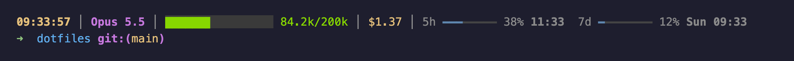

# Claude Code status line

A two-line status line for [Claude Code](https://claude.com/claude-code): usage details on top, a robbyrussell-style prompt below.



From left to right, the top line shows:

| Part | Meaning |
| --- | --- |
| `09:33:57` | Current time (bold) |
| `Opus 5.5` | Model in use |
| bar + `84.2k/200k` | Context window fill; the bar goes green → yellow → orange → red as it fills |
| `$1.37` | Session cost |
| `5h ━━━ 38% 11:33` | 5-hour rate limit used, with the time it resets (bold) |
| `7d ━ 12% Sun 09:33` | 7-day rate limit used, with the time it resets (bold) |

Each part is hidden when Claude Code doesn't send its data. The bottom line shows the current folder, the git branch and a `✗` when the working tree has changes.

## Requirements

- macOS (the script uses BSD `date -j` and `date -r`)
- `jq` and `git`: `brew install jq git`
- A font with box-drawing characters, such as the Nerd Font in [`../ghostty`](../ghostty/config.ghostty)

## Setup

1. Copy the script into `~/.claude`:

   ```sh
   mkdir -p ~/.claude
   cp ~/Desktop/dotfiles/claude/statusline-command.sh ~/.claude/statusline-command.sh
   ```

   Change `~/Desktop/dotfiles` if the repo lives somewhere else. The copy keeps working after the repo is deleted. To pick up later changes, pull the repo and run the same `cp` again; it replaces the old file.

2. Add the `statusLine` block to `~/.claude/settings.json`. Create the file if it doesn't exist, and keep any settings already in it:

   ```json
   {
     "statusLine": {
       "type": "command",
       "command": "bash ~/.claude/statusline-command.sh",
       "refreshInterval": 1
     }
   }
   ```

   `refreshInterval: 1` updates the clock every second.

3. Start a new Claude Code session.

## Test it without Claude Code

Pipe sample JSON into the script:

```sh
echo '{"model":{"display_name":"Opus 5.5"},"cost":{"total_cost_usd":1.37},
  "context_window":{"context_window_size":200000,"total_input_tokens":84200,"used_percentage":42}}' \
  | bash ~/.claude/statusline-command.sh
```
